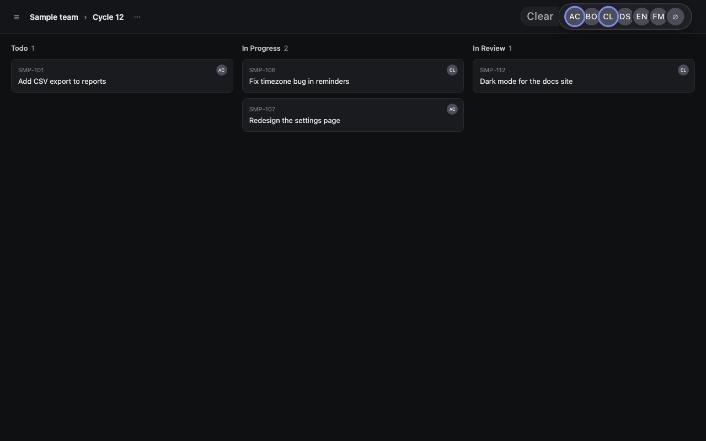

# Assignee Filter for Linear

A Chrome extension that adds a tiny bar of team avatars to Linear's cycle and issue pages, so you can filter by person in one click.

- Click an avatar to filter by that person, and click more to include more people
- Includes a "No assignee" option and a one-click Clear
- Hover to zoom the bar, with the person under your cursor staying in place
- Keeps any other filters you've set, like status or label
- No account or API key, and no data leaves your browser

## Install

1. Download or clone this repo.
2. Go to `chrome://extensions` and turn on **Developer mode**.
3. Click **Load unpacked** and choose this folder.
4. Reload any open Linear tabs.
5. Click the extension's icon and turn on **Show assignee filter**.

## How it works

Linear keeps a view's filter in the page URL as base64url-encoded JSON. The extension reads your team's names and avatars from the copy Linear already keeps in your browser, then updates that URL parameter when you click an avatar. Linear applies the filter as it would one of its own.

See the [privacy policy](store/privacy-policy.md) for details.

---

This is an independent project, not made by, affiliated with or endorsed by Linear.
